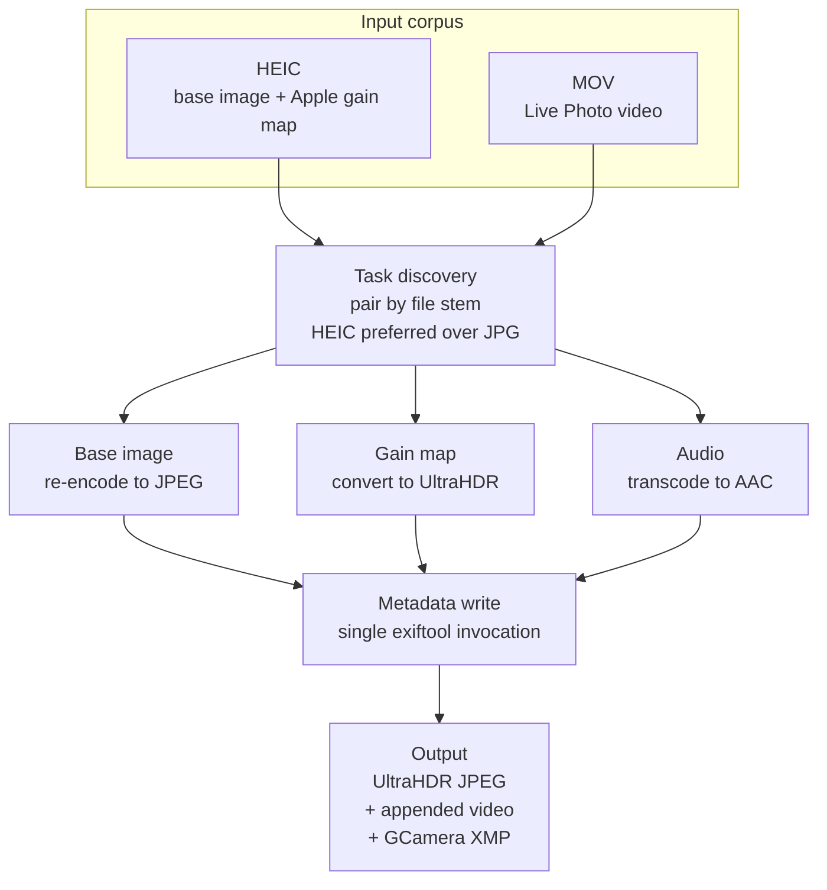
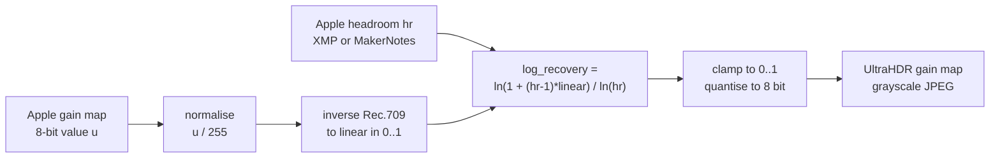

# heic2ultrahdr

[](https://github.com/W0n9/heic2ultrahdr/actions/workflows/release.yml)

**Converting Apple HEIC photographs into UltraHDR JPEG motion photos.**

**Author:** W0n9 · **Version:** 0.1.1 · [中文文档](README.zh-CN.md)

---

## Contents

- [Abstract](#abstract)
- [1. Introduction](#1-introduction)
- [2. Background](#2-background)
- [3. Method](#3-method)
- [4. Implementation](#4-implementation)
- [5. Evaluation](#5-evaluation)
- [6. Limitations](#6-limitations)
- [7. Related Work](#7-related-work)
- [8. Usage](#8-usage)
- [9. Build](#9-build)
- [10. License](#10-license)

---

## Abstract

Apple's iPhone cameras record HDR photographs by storing a *gain map* alongside the
base image inside a HEIC file, and Live Photos additionally pair a short video with
each still. Neither survives a move to Android: Android's UltraHDR format encodes
its gain map differently, and its motion photo convention expects the video to be
appended to the JPEG together with GCamera XMP metadata.

This report describes **heic2ultrahdr**, a command-line tool that converts Apple HEIC
photographs — with or without a paired Live Photo video — into UltraHDR JPEGs. The
core of the conversion is a closed-form mapping from Apple's gain map encoding to the
`log_recovery` encoding defined by Android's HDR image format and ISO/IEC 21496-1,
derived under a specific and explicit choice of gain map metadata parameters.

We evaluate on 508 photographs exported from a real iCloud library. All 508 convert
successfully; all 226 Live Photos are correctly marked as motion photos; 505 outputs
carry UltraHDR gain map metadata, the remaining 3 being source files that contain no
Apple gain map and are correctly emitted as plain JPEGs. A full-corpus run completes
in 118.2 s on a 36-core machine, a throughput of 4.30 photographs per second.

---

## 1. Introduction

HDR photography on mobile devices is built on the same idea in both major ecosystems:
store a standard-dynamic-range base image, plus a *gain map* that records, per pixel,
how much the luminance should be boosted for an HDR display. The base image remains
viewable on SDR hardware, and the gain map carries the extra dynamic range.

The two ecosystems disagree on everything else. Apple encodes the gain map as an
auxiliary image inside the HEIC container, tagged with a private URN, and signals the
available headroom through XMP and MakerNotes fields. Android's UltraHDR — standardised
as ISO/IEC 21496-1 — encodes the gain map as a second JPEG image referenced from an MPF
container, with a `log_recovery` value per pixel and a structured metadata block
describing the mapping's parameters.

Consequently, a photograph taken on an iPhone and copied to an Android device displays
as SDR: the platform cannot interpret the Apple gain map. The same applies to motion:
Apple's Live Photo pairs a HEIC with a MOV, whereas Android's motion photo convention
appends the video to the JPEG and points at it with `GCamera:MicroVideoOffset`.

This work closes that gap. The contributions are:

1. **A closed-form gain map mapping.** A derivation from Apple's gain map encoding to
   UltraHDR's `log_recovery`, valid under the parameter choice given in §3.2, requiring
   no per-image tuning.
2. **An end-to-end conversion pipeline.** Task discovery, base image re-encoding, gain
   map conversion, audio transcoding, motion photo packaging, and metadata writing, in
   a single pass over a directory tree.
3. **An evaluation on real data.** 508 photographs from an actual iCloud export, with
   per-output verification of the produced metadata (§5).

---

## 2. Background

### 2.1 Apple's HDR gain map

An Apple HDR photograph stores, besides the primary image, an auxiliary image of type
`urn:com:apple:photo:2020:aux:hdrgainmap`. Apple's developer documentation describes it
as 8-bit, single-channel, untagged, encoded with the Rec.709 transfer function, and at
one quarter the resolution of the primary image.

The *headroom* is defined as "the ratio of the luminance of the image's brightest white
to the luminance of standard dynamic range (SDR) white, in the image's native color
space". Applying the gain map is a per-pixel multiplication:

```
hdr_rgb = sdr_rgb * (1.0 + (headroom - 1.0) * gainmap)
```

the result being a linear HDR image whose peak is no greater than the headroom.

Two checks establish that a gain map is valid: the `HDRGainMapVersion` key must be
present in the metadata, and the MakerNote dictionary must carry keys `33` and `48` as
32-bit floats. Given the latter two, Apple documents a four-branch piecewise-linear
reconstruction of the headroom from them (§3.2).

The headroom is normally available directly as `xmp:HDRGainMapHeadroom`. Note, however,
that this key — while present in real files and parsed by both libavif and exiftool —
does not appear in Apple's published developer documentation, which mentions only
`HDRGainMapVersion`. The pipeline accordingly treats the XMP value as the primary source
and the documented MakerNote reconstruction as its fallback.

### 2.2 Android UltraHDR and ISO/IEC 21496-1

Android's UltraHDR represents the same information under a different parameterisation.
The gain map is a second JPEG image referenced through an MPF (Multi-Picture Format)
container, and its per-pixel value is a *recovery* rather than a linear gain. The
published encoding is:

```
pixel_gain(x,y) = (Yhdr(x,y) + offset_hdr) / (Ysdr(x,y) + offset_sdr)

map_min_log2 = log2(min_content_boost)
map_max_log2 = log2(max_content_boost)

log_recovery(x,y) = (log2(pixel_gain(x,y)) - map_min_log2)
                  / (map_max_log2 - map_min_log2)
clamped_recovery  = clamp(log_recovery(x,y), 0.0, 1.0)
recovery(x,y)     = pow(clamped_recovery, map_gamma)
encoded_recovery  = floor(recovery(x,y) * 255.0 + 0.5)
```

`max_content_boost` must be at least 1.0 and `min_content_boost` lies in (0.0, 1.0];
`map_gamma` must be positive, with 1.0 recommended. The specification further suggests
`offset_sdr = offset_hdr = 0.015625` (1/64), though as a recommendation rather than a
requirement.

The metadata block carrying these parameters has two interchangeable encodings: an XMP
packet in Adobe's `hdrgm` namespace, and a binary structure in a JPEG APP2 segment
identified by the URN `urn:iso:std:iso:ts:21496:-1`. Android's documentation recommends
writing both and preferring the binary form when decoding. The underlying standard is
ISO/IEC 21496-1, published in 2025; its text is not freely available, so this report
cites the openly published Android and Adobe documents in its place.

### 2.3 The gap between them

Both ecosystems store an SDR base plus a gain map; they parameterise it incompatibly.

| | Apple | Android UltraHDR |
| --- | --- | --- |
| Container | HEIC auxiliary image | JPEG secondary image via MPF |
| Gain map transfer | Rec.709 | unspecified; recovery is quantised directly |
| Headroom signalling | one linear scalar | log2-domain `GainMapMin`/`Max`, `HDRCapacityMin`/`Max` |
| Gain map resolution | 1/4 | implementation-defined; 1/4 per dimension suggested |
| Metadata home | private XMP namespace | `hdrgm` XMP and/or ISO 21496-1 APP2 |

A photograph taken on an iPhone and copied to an Android device therefore displays as
SDR. It is this parameterisation gap that §3.2 bridges — and the two ecosystems are, as
it happens, converging: Apple states that the technique has been submitted for
standardisation as ISO/NP 21496-1, and that it grants a patent licence for it.

---

## 3. Method

The conversion proceeds in three stages: pairing files into tasks, converting the gain
map, and packaging the result as a motion photo.



### 3.1 Task discovery

The input is a directory tree. Files sharing a stem (filename without extension) are
paired into one conversion task; an Apple Live Photo is exactly such a pair of a HEIC
and a MOV.

The rules are:

- **One task per stem.** A stem with both an image and a video yields one task. A stem
  with only an image yields a *static photo* task, converted without a motion photo
  video. This matters under parallelism: without it, two workers could write the same
  output file.
- **HEIC wins ties.** When a stem has several image candidates, HEIC is preferred, as
  it is the only format carrying an Apple gain map. The losing candidate is recorded as
  a non-fatal issue.
- **Deterministic ordering.** Candidates are ordered by format priority and then by
  path, so repeated runs produce identical task sets.
- **Non-fatal issues are collected, not raised.** Duplicate candidates, symlinks,
  non-HEIC images, and unreadable files become recorded issues. A missing or
  non-directory root, by contrast, is a hard error.

Output is written next to the input as `<stem>.jpg`.

### 3.2 Gain map conversion

This is the core of the work. Let `hr` be the Apple headroom and `u ∈ [0, 255]` the
8-bit value of a gain map pixel. The conversion is:



Step by step:

1. **Normalise and linearise.** The stored gain map value must be linearised before use.
   Apple's documentation specifies the Rec.709 transfer function for this, and this
   implementation applies its inverse:

   ```
   linear = u / 4.5                            if u < 0.081
   linear = ((u + 0.099) / 1.099) ^ (1 / 0.45) otherwise
   ```

   The inverse sRGB EOTF is a plausible alternative and has been used here in the past.
   It is not the same function — breakpoint 0.081 against 0.04045, exponent approximately
   2.222 against 2.4 — and §6 records how far apart the two actually land.

2. **Choose the UltraHDR parameters.** Following Android's HDR image format and Apple's
   documented HDR effect, we set `offset_hdr = offset_sdr = 0`,
   `min_content_boost = 1.0`, `max_content_boost = hr`, and `map_gamma = 1.0`.

3. **Derive `log_recovery`.** Under that choice, the general UltraHDR relation

   ```
   log_recovery = (log2(pixel_gain) - log2(min_content_boost))
                / (log2(max_content_boost) - log2(min_content_boost))
   ```

   collapses to

   ```
   log_recovery = log2(pixel_gain) / log2(hr)
                = ln(pixel_gain) / ln(hr)
                = ln(1 + (hr - 1) * linear) / ln(hr)
   ```

   The last step substitutes the linear gain map value for `pixel_gain`, since Apple's
   gain map encodes the multiplier applied to the SDR pixel.

4. **Clamp and quantise.** The result is clamped to `[0, 1]` and stored as
   `round(log_recovery * 255)`.

The resulting grayscale image is encoded as a JPEG and handed to libultrahdr together
with a metadata block whose `max_content_boost` is `hr` and whose other fields follow
the parameter choice above.

**Headroom recovery.** When `xmp:HDRGainMapHeadroom` is absent, the headroom is
reconstructed from the MakerNotes markers `HDRHeadroom` (marker 33) and `HDRGain`
(marker 48) through a four-branch piecewise-linear fit, followed by `hr = 2^stops`.
This reconstruction is an empirical one, credited in the source to
[johncf/apple-hdr-heic](https://github.com/johncf/apple-hdr-heic/blob/e64716c29abc91a3b40543d7c47fb0f526608982/src/apple_hdr_heic/metadata.py#L17),
cross-referenced against exiftool's
[`Apple.pm`](https://github.com/exiftool/exiftool/blob/405674e0/lib/Image/ExifTool/Apple.pm).
It is the one part of the pipeline that is not derived from a published specification,
and is treated as such in §6.

**Preconditions.** The pipeline requires the gain map to be 8-bit, the primary image to
be YCbCr 4:2:0 8-bit, and — when headroom is present — the colour profile to be
Display P3. These are properties of Apple's encoder, not restrictions invented here.

### 3.3 Motion photo packaging

For a Live Photo, the paired video is appended to the JPEG and described with GCamera
XMP metadata following the current Motion Photo 1.0 specification:

- `GCamera:MotionPhoto = 1` and `MotionPhotoVersion = 1` mark the file as a motion
  photo;
- `GCamera:MotionPhotoPresentationTimestampUs = 1500000` places the still 1.5 s into
  the video, matching where Apple selects the key frame of a Live Photo;
- a `Container:Directory` declares the file's composition — the first item is the
  primary image (`image/jpeg` / `Primary`), the second the video (`video/mp4` /
  `MotionPhoto`) with `Item:Length` recording its byte count and `Item:Padding = 0`.
  Spec-compliant readers locate the video at the end of the file from this directory;
  applications implementing the spec, WeChat among them, recognise only this form.

The legacy MicroVideo convention has been removed from the spec, which requires
readers to ignore it, and is not written here; gallery builds old enough to know only
MicroVideo are deliberately out of scope (current Xiaomi Gallery output already uses
the spec form, and WeChat accepts these files in practice).

This XMP does not go through exiftool — exiftool reads but cannot write the
MotionPhoto and Container tags; the packet is generated directly and written as an
APP1 segment of the JPEG (see `src/i2a/xmp.rs`).

Before appending, every video is remuxed through libavformat into a faststart
(moov-first) MP4 branded mp42: an Apple QuickTime MOV appended as-is (`ftyp qt  `,
moov at the end) makes WeChat report the live photo as unpreviewable and fall back to
a static image. Remuxing also drops the MOV's metadata tracks. For audio, Apple
encodes Live Photo audio as `pcm_s16le`, which Android players do not widely support,
so such tracks are transcoded to AAC at 128 kbit/s; videos already carrying AAC or
AC-3 audio, or no audio at all, are stream-copied untouched.

The remaining output metadata — tags copied from the source image plus Xiaomi's
private `Exif 0x8897` motion-photo marker — is written in a **single** exiftool
invocation. An earlier design wrote it in two passes, each of which made exiftool
rewrite the entire output file; collapsing them removed one to two full rewrites per
photograph.

---

## 4. Implementation

### 4.1 Module structure

The project is a Rust crate of roughly 1,400 lines, split so that each concern has one
entry point:

| Module | Responsibility |
| --- | --- |
| `discover` | Task discovery; single public seam `discover(root, &DiscoverOptions) -> Discovery` |
| `i2a::convert` | HEIC decoding and the gain map conversion of §3.2 |
| `i2a::merge` | Video appending, metadata writing, file-time alignment |
| `i2a::video` | Audio transcoding via rsmpeg |
| `i2a::mod` | Orchestration of the three stages |
| `utils::exiftool` | Batched tag reads — one process for all tags of a file |
| `bin/heic2ultrahdr` | CLI, parallel execution via rayon, progress reporting via indicatif |

Two implementation choices are worth noting. First, exiftool is invoked once per
photograph for reads and once for writes, rather than the five-plus invocations a
naive implementation would need; process startup dominates that cost. Second, the
conversion stage installs a guard that deletes a partially written output if any later
stage fails, so a failed run never leaves a truncated JPEG behind.

### 4.2 Dependencies

The C dependencies are built from source and statically linked:

| Library | Version | Role |
| --- | --- | --- |
| libheif | v1.19.5 | HEIC container and auxiliary image decoding |
| libde265 | v1.0.15 | HEVC decoding |
| libultrahdr | v1.4.0 | UltraHDR gain map encoding |
| libjpeg-turbo | 3.1.0 | JPEG encoding |
| ffmpeg | release/7.1 | Audio transcoding (LGPL build) |

On the Rust side the notable dependencies are `libheif-rs`, `libultrahdr-rs`,
`turbojpeg`, and `rsmpeg`. All versions are pinned; the build scripts fetch specific
tags, and `Cargo.lock` is committed.

### 4.3 Build and CI

Continuous integration builds all three platforms on every push and pull request —
Ubuntu, macOS, and Windows — and runs the test suite on Linux and macOS.

The Windows build goes through vcpkg, pinned to a specific commit whose ffmpeg port is
still version 8.x: `rsmpeg` 0.15 targets the ffmpeg 6/7 API and does not compile
against 9. The Linux build pins clang 18, because the default clang on newer Ubuntu
releases is too new for the bindgen versions in use, producing truncated structs when
parsing ffmpeg headers.

A `Dockerfile` builds everything from scratch and produces a runtime image with
`heic2ultrahdr` as its entrypoint, exiftool included.

---

## 5. Evaluation

Measurements were taken on a 36-core Linux workstation with a release build
(`lto = true`, `strip = true`). The full data is recorded in
[`notes/evaluation.md`](notes/evaluation.md).

### 5.1 Corpus

A real iCloud photo library export: 760 files, 8.6 GB.

| Category | Count |
| --- | --- |
| HEIC inputs | 508 |
| ├ paired with a MOV (Live Photo) | 226 |
| └ unpaired (static photo) | 282 |
| MOV inputs | 234 |
| └ without a matching image | 8 |
| Non-HEIC images (jpg / png) | 17 |

### 5.2 Throughput

| Metric | Value |
| --- | --- |
| Conversion tasks | 508 |
| Succeeded | 508 (100%) |
| Failed | 0 |
| Wall-clock time | 118.2 s |
| Throughput | 4.30 photos/s |
| Serial equivalent | 0.233 s/photo |
| Total output | 3.94 GiB |
| Mean output size | 7.93 MiB |

Per-task timings, which include parallel queueing rather than pure computation, differ
sharply by task type: static photos have a median of 3.01 s, while Live Photos have a
median of 8.06 s — the extra cost being one audio transcode plus appending an entire
video.

### 5.3 Output correctness

Every one of the 508 outputs was verified by reading its bytes directly, without
relying on a metadata tool's interpretation:

| Check | Result |
| --- | --- |
| Valid JPEG container | 508 / 508 |
| UltraHDR gain map present (ISO/IEC 21496-1 metadata) | 505 / 508 |
| GCamera `MicroVideo` flag present | 226 — exactly the number of paired Live Photos |
| MPF two-image structure (base + gain map) | verified by sampling |

**On the 505/508.** The three remaining sources contain no Apple gain map at all:
the string `hdrgainmap` occurs zero times in each (a normal Apple photograph has one
occurrence), and they carry no Make or Model tag while nonetheless carrying HEVC
content light level metadata — the profile of a HEIC produced by some third-party
tool rather than by a camera. The pipeline detects the absence and emits a plain JPEG,
which is the correct behaviour rather than a failure.

---

## 6. Limitations

- **Input scope.** Only HEIC inputs are converted. The gain map must be 8-bit and the
  primary image YCbCr 4:2:0 8-bit; when headroom metadata is present the colour profile
  must be Display P3. Other HEIC images are copied or skipped rather than converted.
- **Heuristic headroom recovery.** When `xmp:HDRGainMapHeadroom` is absent, headroom is
  reconstructed by an empirically fitted piecewise-linear function (§3.2) rather than by
  a published specification. Its accuracy is not independently characterised here.
- **No perceptual quality measurement.** This evaluation establishes that the outputs are
  structurally correct — valid containers, correct gain map metadata, correct motion photo
  framing — but does not measure HDR reconstruction fidelity against the original, for
  example by PSNR or SSIM on the reconstructed HDR signal. Doing so requires rendering
  both the source and the output to HDR and comparing them, which is left to future work.
- **Video rotation.** Some videos carry a rotation flag. Video players honour it; photo
  albums may not. `scripts/preprocess-fix-rotations.py` re-encodes such videos beforehand.
- **File timestamps.** Files obtained from internet downloads may carry incorrect creation
  or modification times. `scripts/postprocess-set-file-times.py` restores them from EXIF.
- **Non-Apple HEIC inputs.** As §5.3 shows, a HEIC without an Apple gain map yields a
  plain JPEG. This is correct, but it means a mixed input directory produces a mixed
  output directory.
- **Gain map transfer function.** Apple's documentation specifies the Rec.709 transfer
  function, and this implementation applies its inverse. The inverse sRGB EOTF is a
  plausible alternative and was used here until it was measured. The two differ in
  breakpoint (0.081 against 0.04045) and exponent (approximately 2.222 against 2.4):
  the linearised value they produce differs by 21% at u = 0.5, and by considerably more
  further down — a factor of 2.9 in the linear segment below the breakpoint. Those
  figures overstate the visible consequence, because the log-recovery mapping that
  follows compresses them. Across 60 photographs sampled from a real library the two
  choices disagree on 95% of pixels (mean 11.5 of 255 levels, maximum 17) yet shift the
  reconstructed HDR luminance by only 0.08–0.16 stops — consistently brighter with
  Rec.709, never darker — and a side-by-side comparison on an HDR display does not
  distinguish them. Rec.709 is used because it is the documented behaviour; **which
  function Apple's encoder actually applies remains unestablished**, since no
  independent reference was available to settle it. See §3.2 for the formula and
  `notes/hdr-formats-research.md` (A.7, A.8.1) for the measurement.
- **No `hdrgm` XMP in the output.** Outputs carry ISO 21496-1 metadata in an APP2 segment
  but no `hdrgm` XMP packet. Android's documentation recommends writing both and
  preferring the binary form when decoding, so conforming decoders should read the
  current output correctly — but the omission has not been tested across the full range
  of Android gallery applications.

---

## 7. Related Work

### 7.1 Open-source implementations and tooling

**libultrahdr** is Google's reference implementation of the UltraHDR format and the
encoder this project uses. Its README describes five encoding scenarios, API-0 through
API-4; this project uses API-4 — "SDR compressed, gain map compressed and GainMap
metadata exist" — the path in which base image and gain map are supplied pre-compressed
and only the metadata is synthesised.

**libavif** added an experimental gain map API in version 1.1.0 (July 2024), and is to
our knowledge the only general-purpose library that parses *Apple's* gain map XMP
format: `avifJPEGParseGainMapXMPPropertiesAppleFormat` reads `HDRGainMapHeadroom` from
the Apple namespace and converts it into the ISO 21496-1 fractional representation.
libavif's gain map work targets AVIF's `tmap` derived image item rather than JPEG.

**FFmpeg** implements both metadata encodings on the JPEG side — `ff_gain_map_params_to_xmp`
serialises an Ultra HDR XMP packet, while a separate path handles the ISO 21496-1 binary
blob — so it can read and write gain maps without depending on libultrahdr.

**ImageMagick** gained Ultra HDR support through `coders/uhdr.c`, which calls libultrahdr
directly and reads `hdrgm` properties for the gain map parameters.

**libheif** can *retrieve* an Apple gain map as a generic auxiliary image, but does not
interpret its semantics or produce UltraHDR. A community issue requesting Apple gain map
support ([#1685](https://github.com/strukturag/libheif/issues/1685)) remains open.

**exiftool** carries three relevant tag families: `XMP-hdrgm` (Adobe gain map),
`XMP-HDRGainMap` (Apple, containing `HDRGainMapVersion`), and the MakerNotes
`HDRHeadroom` / `HDRGain` pair. This project uses it both to read Apple's metadata and to
write the output's.

**apple-hdr-heic** decodes Apple gain maps into linear float or PQ-encoded HDR
representations (EXR, PNG) rather than converting between ecosystems. Its metadata
reading logic is the source of the headroom heuristic credited in §3.2.

### 7.2 Academic work

Gain map research has begun to appear in the imaging literature. Canham et al.,
*Gamma Maps: Non-linear Gain Maps for HDR Reconstruction* (London Imaging Meeting 2024),
propose replacing the multiplicative gain map with a per-pixel exponent map, reporting
improved HDR reconstruction quality across several metrics. The same group's
*Gain-MLP* (ICCV 2025) encodes the gain map with a lightweight MLP at a fixed 10 KB
overhead, independent of image size and encoding parameters. Both address the *encoding*
of gain maps rather than their translation between container formats, which is the
problem addressed here.

### 7.3 Positioning

To our knowledge, no published work addresses conversion between Apple's and Android's
gain map parameterisations. The open-source landscape divides into libraries that
produce UltraHDR from SDR/HDR pairs (libultrahdr, ImageMagick), libraries that parse one
or both metadata encodings (libavif, FFmpeg, exiftool), and tools that decode Apple gain
maps into HDR representations without re-encoding them (apple-hdr-heic). This work sits
at the intersection: it consumes Apple's parameterisation and produces Android's.

---

## 8. Usage

```
Usage: heic2ultrahdr [OPTIONS] --original <ORIGINAL> <PATH>

Arguments:
  <PATH>  Path to the directory containing images and videos to convert

Options:
  -e, --exiftool <EXIFTOOL>
          Path to the exiftool executable
  -j, --parallel
          Run in parallel mode
  -o, --original <ORIGINAL>
          What to do with the original files [possible values: keep, delete]
      --overwrite-existing
          Overwrite output file if already exist
      --output-suffix <OUTPUT_SUFFIX>
          Add some suffix in output file to avoid filename collision. For example, "--output-suffix _merge"
      --image-extensions <IMAGE_EXTENSIONS>
          Image extensions. Default: "heic,jpg,jpeg"
      --video-extensions <VIDEO_EXTENSIONS>
          Video extensions. Default: "mov,mp4"
  -q, --image-quality <IMAGE_QUALITY>
          Image quality. Default: 85 [default: 85]
  -g, --gainmap-quality <GAINMAP_QUALITY>
          Gainmap quality. Default: 85 [default: 85]
      --strict
          Strict mode: exit on multiple images / videos with same name
  -v, --verbose
          Print more detailed runtime information
  -h, --help
          Print help
  -V, --version
          Print version
```

### Example

```bash
# Typical usage — exiftool is looked up in PATH:
heic2ultrahdr ~/Pictures/iPhone -o keep -j --strict

# Windows with a custom exiftool path:
heic2ultrahdr d:\tmp\iPhone -o delete -e 'c:\Program Files\exiftool\exiftool.exe' -j --strict
```

---

## 9. Build

Depends on several C packages:

- libclang (compile time only)
- libheif
- libultrahdr → libjpeg (dummy for libturbojpeg)
- libturbojpeg
- libffmpeg (LGPL)

### Build on Linux

See the workflow file [.github/workflows/release.yml](.github/workflows/release.yml).
For a local build, run `scripts/linux-build-all.sh <deps-dir> <pkgconfig-dir>` to build
the C dependencies, then `source scripts/local-env.sh` so cargo can find them.

Or use Docker: `docker build -t heic2ultrahdr .` builds everything from scratch and
produces a runtime image with `heic2ultrahdr` as the entrypoint (exiftool included).

### Build on Windows

vcpkg and Visual Studio required. See the workflow file. CI pins vcpkg to commit
`cf1f98216d` (the last one where the ffmpeg port was still 8.1.2), because rsmpeg 0.15
only supports the ffmpeg 6/7 API.

### Build on macOS

See the workflow file.

### Prebuilt binaries

Each GitHub Release ships three-platform builds: Linux x64, macOS arm64, Windows x64.
The prebuilt binaries statically link LGPL ffmpeg; see
[README-prebuilt.md](README-prebuilt.md) for the license notice.

---

## 10. License

Apache License 2.0. See [LICENSE](LICENSE).

The prebuilt binaries additionally contain statically linked LGPL ffmpeg; the
corresponding notice is in [README-prebuilt.md](README-prebuilt.md).
