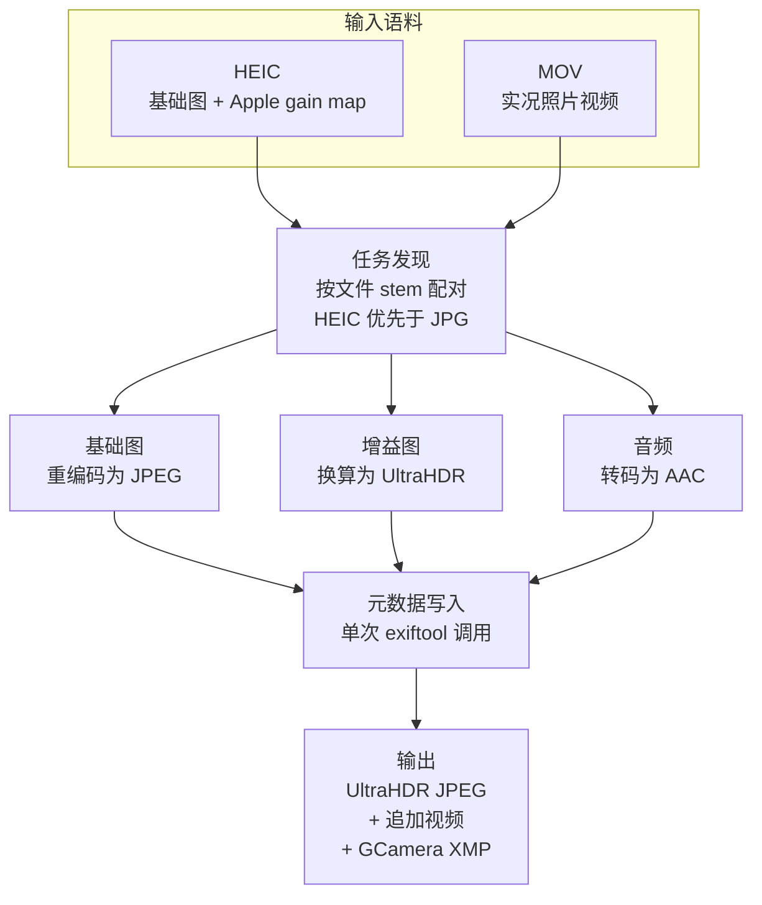
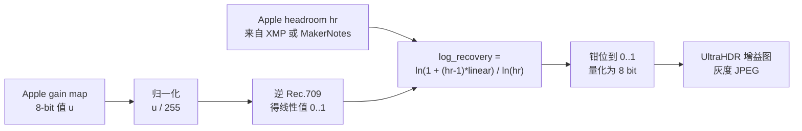

# heic2ultrahdr

[](https://github.com/W0n9/heic2ultrahdr/actions/workflows/release.yml)

**把 Apple HEIC 照片转换为 UltraHDR JPEG 动态照片。**

**作者：** W0n9 · **版本：** 0.1.1 · [English](README.md)

---

## 目录

- [摘要](#摘要)
- [1. 引言](#1-引言)
- [2. 背景](#2-背景)
- [3. 方法](#3-方法)
- [4. 实现](#4-实现)
- [5. 评估](#5-评估)
- [6. 局限](#6-局限)
- [7. 相关工作](#7-相关工作)
- [8. 用法](#8-用法)
- [9. 构建](#9-构建)
- [10. 许可](#10-许可)

---

## 摘要

Apple 的 iPhone 相机通过在 HEIC 文件中、基础图之外再存一张 *gain map*（增益图）来记录 HDR 照片；实况照片（Live Photo）还会为每张静态图配一段短视频。这两者在迁移到 Android 后都无法保留：Android 的 UltraHDR 格式采用不同的增益图编码，其动态照片约定则要求把视频追加到 JPEG 末尾并配以 GCamera XMP 元数据。

本报告介绍 **heic2ultrahdr** —— 一个把 Apple HEIC 照片（无论是否配有实况照片视频）转换为 UltraHDR JPEG 的命令行工具。转换的核心，是在一组明确给定的增益图元数据参数下，把 Apple 的增益图编码闭式地映射为 Android HDR Image Format 与 ISO/IEC 21496-1 所定义的 `log_recovery` 编码。

我们在 508 张来自真实 iCloud 图库的照片上做了评估。508 张全部转换成功；226 个实况照片全部被正确标记为动态照片；505 个输出带 UltraHDR 增益图元数据，其余 3 个的源文件本身不含 Apple 增益图，被正确地输出为普通 JPEG。全量运行在 36 核机器上耗时 118.2 秒，吞吐为每秒 4.30 张。

---

## 1. 引言

移动端 HDR 摄影在两大生态里建立在同一个想法之上：存一张标准动态范围的基础图，外加一张 *gain map*，逐像素记录在 HDR 显示时应把亮度提升多少。基础图在 SDR 硬件上依然可见，增益图则承载额外的动态范围。

除此之外，两大生态没有任何一致之处。Apple 把增益图作为 HEIC 容器内的辅助图（auxiliary image）存放，用一个私有 URN 标记，并通过 XMP 与 MakerNotes 字段告知可用的 headroom。Android 的 UltraHDR —— 已标准化为 ISO/IEC 21496-1 —— 把增益图编码为一张由 MPF 容器引用的第二张 JPEG，逐像素存 `log_recovery` 值，并配一个描述映射参数的结构化元数据块。

因此，一张 iPhone 拍摄、拷贝到 Android 设备上的照片会以 SDR 呈现：平台无法解读 Apple 的增益图。动态照片同理：Apple 的实况照片把 HEIC 与 MOV 配对，而 Android 的动态照片约定是把视频追加到 JPEG 末尾，并用 `GCamera:MicroVideoOffset` 指向它。

本工作填补这一空缺。贡献如下：

1. **闭式的增益图映射。** 在 §3.2 给出的参数选择下，从 Apple 增益图编码到 UltraHDR `log_recovery` 的推导，无需逐图调参。
2. **端到端的转换流水线。** 任务发现、基础图重编码、增益图换算、音频转码、动态照片封装与元数据写入，一趟遍历整个目录树完成。
3. **基于真实数据的评估。** 508 张来自真实 iCloud 导出的照片，逐输出校验其产出的元数据（§5）。

---

## 2. 背景

### 2.1 Apple 的 HDR gain map

一张 Apple HDR 照片除主图之外，还存有一张类型为 `urn:com:apple:photo:2020:aux:hdrgainmap` 的辅助图。Apple 的开发者文档把它描述为 8-bit、单通道、untagged、以 Rec.709 传递函数编码，分辨率为主图的四分之一。

*headroom* 的定义是「图像最亮白的亮度与标准动态范围（SDR）白的亮度之比，在该图像的 native color space 中」。应用增益图是一次逐像素乘法：

```
hdr_rgb = sdr_rgb * (1.0 + (headroom - 1.0) * gainmap)
```

结果是一张线性 HDR 图，其峰值不超过 headroom。

有两项校验用于确认增益图有效：元数据中必须存在 `HDRGainMapVersion` 键，且 MakerNote 字典必须以 32-bit 浮点携带 `33` 与 `48` 两个键。在后两者存在时，Apple 文档给出了由它们重建 headroom 的四分支分段线性公式（§3.2）。

headroom 通常可直接从 `xmp:HDRGainMapHeadroom` 取得。但需注意：这个键虽然真实存在于文件中、且被 libavif 与 exiftool 解析，却**不在 Apple 公开的开发者文档里** —— 那篇文档只提到 `HDRGainMapVersion`。因此本流水线把 XMP 中的值作为首选来源，把有文档记载的 MakerNote 重建作为回退。

### 2.2 Android UltraHDR 与 ISO/IEC 21496-1

Android 的 UltraHDR 以另一套参数化表示同样的信息。增益图是一张由 MPF（Multi-Picture Format）容器引用的第二张 JPEG，逐像素的值是 *recovery* 而非线性增益。公开的编码流程为：

```
pixel_gain(x,y) = (Yhdr(x,y) + offset_hdr) / (Ysdr(x,y) + offset_sdr)

map_min_log2 = log2(min_content_boost)
map_max_log2 = log2(max_content_boost)

log_recovery(x,y) = (log2(pixel_gain(x,y)) - map_min_log2)
                  / (map_max_log2 - map_min_log2)
clamped_recovery  = clamp(log_recovery(x,y), 0.0, 1.0)
recovery(x,y)     = pow(clamped_recovery, map_gamma)
encoded_recovery  = floor(recovery(x,y) * 255.0 + 0.5)
```

`max_content_boost` 必须不小于 1.0，`min_content_boost` 取值于 (0.0, 1.0]；`map_gamma` 必须为正，推荐取 1.0。规范另建议 `offset_sdr = offset_hdr = 0.015625`（1/64），但这是建议而非要求。

承载这些参数的元数据块有两种可互换的编码：Adobe `hdrgm` 命名空间下的 XMP 包，以及 JPEG APP2 段中由 URN `urn:iso:std:iso:ts:21496:-1` 标识的二进制结构。Android 的文档建议两者都写，解码时优先二进制形式。其背后的标准是 2025 年发布的 ISO/IEC 21496-1；该标准正文不公开可得，因此本报告引用公开的 Android 与 Adobe 文档代替。

### 2.3 两者的差距

两大生态都存「SDR 基础图 + 增益图」，但参数化方式互不兼容。

| | Apple | Android UltraHDR |
| --- | --- | --- |
| 容器 | HEIC 辅助图 | JPEG 经 MPF 引用的第二张图 |
| 增益图传递函数 | Rec.709 | 未规定；recovery 直接量化 |
| headroom 信号 | 单一线性标量 | log2 域的 `GainMapMin`/`Max`、`HDRCapacityMin`/`Max` |
| 增益图分辨率 | 1/4 | 实现定义；建议每维 1/4 |
| 元数据所在 | 私有 XMP 命名空间 | `hdrgm` XMP 与/或 ISO 21496-1 APP2 |

因此，一张 iPhone 拍摄、拷贝到 Android 设备上的照片会以 SDR 呈现。§3.2 所弥合的正是这一参数化差距 —— 而两大生态实际上正在收敛：Apple 声明该技术已作为 ISO/NP 21496-1 提交标准化，并承诺给予专利许可。

---

## 3. 方法

转换分三个阶段：把文件配对成任务、换算增益图、把结果封装为动态照片。



### 3.1 任务发现

输入是一棵目录树。共享同一 stem（去扩展名的文件名）的文件被配对成一个转换任务；Apple 实况照片正是这样一对 HEIC 与 MOV。

规则如下：

- **每个 stem 只产生一个任务。** 既有图又有视频的 stem 产生一个任务；只有图的 stem 产生一个*静态照片*任务，转换时不追加动态照片视频。这在并行下至关重要：否则两个 worker 可能写同一个输出文件。
- **HEIC 优先。** 当一个 stem 有多个图片候选时，优先选 HEIC —— 它是唯一携带 Apple 增益图的格式。落选的候选记为非致命 issue。
- **顺序确定。** 候选先按格式优先级、再按路径排序，因此重复运行产生完全一致的任务集合。
- **非致命问题被收集而非抛出。** 重复候选、符号链接、非 HEIC 图片、不可读文件都记为 issue。根目录不存在或不是目录，则是硬错误。

输出写在输入旁，名为 `<stem>.jpg`。

### 3.2 增益图换算

这是本工作的核心。设 `hr` 为 Apple headroom，`u ∈ [0, 255]` 为增益图某个像素的 8-bit 值。换算如下：



逐步说明：

1. **归一化并线性化。** 存储的增益图值在使用前必须线性化。Apple 文档为此规定的是 Rec.709 传递函数，本实现施加其反函数：

   ```
   linear = u / 4.5                            若 u < 0.081
   linear = ((u + 0.099) / 1.099) ^ (1 / 0.45) 否则
   ```

   逆 sRGB EOTF 是一个看似合理的替代，本仓库过去也用过。两者并非同一个函数 —— 分段点 0.081 对 0.04045，指数约 2.222 对 2.4 —— 实际差多远记录在 §6。

2. **选定 UltraHDR 参数。** 依据 Android 的 HDR image format 与 Apple 文档所述的 HDR 效果，取 `offset_hdr = offset_sdr = 0`、`min_content_boost = 1.0`、`max_content_boost = hr`、`map_gamma = 1.0`。

3. **推导 `log_recovery`。** 在该选择下，UltraHDR 的一般关系式

   ```
   log_recovery = (log2(pixel_gain) - log2(min_content_boost))
                / (log2(max_content_boost) - log2(min_content_boost))
   ```

   退化为

   ```
   log_recovery = log2(pixel_gain) / log2(hr)
                = ln(pixel_gain) / ln(hr)
                = ln(1 + (hr - 1) * linear) / ln(hr)
   ```

   最后一步把线性增益图值代入 `pixel_gain` —— Apple 的增益图编码的正是施加于 SDR 像素的倍数。

4. **钳位并量化。** 结果钳位到 `[0, 1]`，存为 `round(log_recovery * 255)`。

得到的灰度图编码为 JPEG，连同元数据块一起交给 libultrahdr，其中 `max_content_boost` 为 `hr`，其余字段遵循上述参数选择。

**headroom 反推。** 当 `xmp:HDRGainMapHeadroom` 缺失时，headroom 由 MakerNotes 的 `HDRHeadroom`（marker 33）与 `HDRGain`（marker 48）经一个四分支分段线性拟合重建，再取 `hr = 2^stops`。这一重建是经验性的，源码中已致谢其出处
[johncf/apple-hdr-heic](https://github.com/johncf/apple-hdr-heic/blob/e64716c29abc91a3b40543d7c47fb0f526608982/src/apple_hdr_heic/metadata.py#L17)，
并与 exiftool 的
[`Apple.pm`](https://github.com/exiftool/exiftool/blob/405674e0/lib/Image/ExifTool/Apple.pm)
交叉核对。它是整条流水线中唯一不是从公开规范推导而来的部分，§6 据此对待它。

**前置条件。** 流水线要求增益图为 8-bit、主图为 YCbCr 4:2:0 8-bit，且在存在 headroom 元数据时色彩配置为 Display P3。这些是 Apple 编码器的性质，而非此处额外施加的限制。

### 3.3 动态照片封装

对于实况照片，配对的视频被追加到 JPEG 末尾，并以 Android 相册应用所能理解的 GCamera XMP 约定加以描述：

- `GCamera:MicroVideo = 1` 与 `MicroVideoVersion = 1` 把文件标记为动态照片；
- `GCamera:MicroVideoOffset` 记录追加的字节数，播放器因此从 `文件大小 - MicroVideoOffset` 处开始读取视频；
- `GCamera:MicroVideoPresentationTimestampUs = 1500000` 把静态画面定位在视频的第 1.5 秒，与 Apple 为实况照片选取关键帧的位置一致。

追加之前会检查视频的音轨。Apple 用 `pcm_s16le` 编码实况照片音频，Android 播放器普遍不支持；这类音轨会被转码为 128 kbit/s 的 AAC。已带 AAC 或 AC-3 音频的视频原样追加，无音轨的视频亦原样追加。

输出的全部元数据 —— 从源图拷贝的 tag 加上 GCamera 字段 —— 在**单次** exiftool 调用中写完。早先的设计分两趟写入，每一趟都让 exiftool 把整个输出文件重写一遍；合并之后，每张照片省下一到两次完整重写。

---

## 4. 实现

### 4.1 模块结构

项目是一个约 1,400 行的 Rust crate，按「每个关注点只有一个入口」拆分：

| 模块 | 职责 |
| --- | --- |
| `discover` | 任务发现；唯一的公共 seam 为 `discover(root, &DiscoverOptions) -> Discovery` |
| `i2a::convert` | HEIC 解码与 §3.2 的增益图换算 |
| `i2a::merge` | 视频追加、元数据写入、文件时间对齐 |
| `i2a::video` | 经 rsmpeg 做音频转码 |
| `i2a::mod` | 三阶段编排 |
| `utils::exiftool` | 批量读取 tag —— 一个文件只起一个进程 |
| `bin/heic2ultrahdr` | CLI，rayon 并行，indicatif 进度显示 |

有两处实现选择值得说明。其一，每张照片的 exiftool 调用为读一次、写一次，而非朴素实现所需的五次以上；进程启动开销在该成本中占主导。其二，转换阶段装了一个 guard：若后续任一阶段失败，它会删掉写了一半的输出，因此失败的运行不会留下截断的 JPEG。

### 4.2 依赖

C 依赖从源码构建并静态链接：

| 库 | 版本 | 作用 |
| --- | --- | --- |
| libheif | v1.19.5 | HEIC 容器与辅助图解码 |
| libde265 | v1.0.15 | HEVC 解码 |
| libultrahdr | v1.4.0 | UltraHDR 增益图编码 |
| libjpeg-turbo | 3.1.0 | JPEG 编码 |
| ffmpeg | release/7.1 | 音频转码（LGPL 构建） |

Rust 侧主要依赖为 `libheif-rs`、`libultrahdr-rs`、`turbojpeg` 与 `rsmpeg`。所有版本均已钉死；构建脚本拉取指定 tag，`Cargo.lock` 入库。

### 4.3 构建与 CI

持续集成在每次 push 与 pull request 上构建全部三个平台 —— Ubuntu、macOS、Windows —— 并在 Linux 与 macOS 上运行测试套件。

Windows 构建经 vcpkg，钉在一个 ffmpeg port 仍为 8.x 的特定 commit 上：`rsmpeg` 0.15 面向 ffmpeg 6/7 API，无法在 9 上编译。Linux 构建钉 clang 18，因为较新 Ubuntu 上的默认 clang 对所用的 bindgen 版本而言过新，解析 ffmpeg 头文件时会生成残缺的 struct。

`Dockerfile` 从零构建全部依赖，产出以 `heic2ultrahdr` 为入口的运行镜像，已含 exiftool。

---

## 5. 评估

测量在一台 36 核 Linux 工作站上进行，使用 release 构建（`lto = true`、`strip = true`）。完整数据记录于
[`notes/evaluation.md`](notes/evaluation.md)。

### 5.1 语料

一份真实的 iCloud 照片图库导出：760 个文件，8.6 GB。

| 类别 | 数量 |
| --- | --- |
| HEIC 输入 | 508 |
| ├ 配有 MOV（实况照片） | 226 |
| └ 无配对（静态照片） | 282 |
| MOV 输入 | 234 |
| └ 无对应图片 | 8 |
| 非 HEIC 图片（jpg / png） | 17 |

### 5.2 吞吐

| 指标 | 数值 |
| --- | --- |
| 转换任务 | 508 |
| 成功 | 508（100%） |
| 失败 | 0 |
| 墙钟耗时 | 118.2 秒 |
| 吞吐 | 4.30 张/秒 |
| 等效串行 | 0.233 秒/张 |
| 输出总计 | 3.94 GiB |
| 平均输出 | 7.93 MiB |

单任务耗时（含并行排队而非纯计算）按类型差异明显：静态照片中位数 3.01 秒，实况照片中位数 8.06 秒 —— 多出的成本是一次音频转码加上追加整段视频。

### 5.3 输出正确性

508 个输出逐一校验，方式是直接读取其字节，而不依赖某个元数据工具的解读：

| 检查项 | 结果 |
| --- | --- |
| JPEG 容器有效 | 508 / 508 |
| 含 UltraHDR 增益图（ISO/IEC 21496-1 元数据） | 505 / 508 |
| 含 GCamera `MicroVideo` 标记 | 226 —— 与配对的实况照片数精确一致 |
| MPF 双图结构（基础图 + 增益图） | 抽样验证通过 |

**关于 505/508。** 其余 3 个源文件根本不含 Apple 增益图：`hdrgainmap` 字符串在每个文件里出现 0 次（正常 Apple 照片出现 1 次），且它们没有 Make 或 Model tag，却带着 HEVC 的 content light level 元数据 —— 这是由某个第三方工具而非相机产出的 HEIC 的特征。流水线检出其缺失并输出普通 JPEG，这是正确行为而非失败。

---

## 6. 局限

- **输入范围。** 只转换 HEIC 输入。增益图必须为 8-bit，主图必须为 YCbCr 4:2:0 8-bit；存在 headroom 元数据时色彩配置必须为 Display P3。其他 HEIC 图片被拷贝或跳过，而非转换。
- **启发式的 headroom 反推。** 当 `xmp:HDRGainMapHeadroom` 缺失时，headroom 由一个经验拟合的分段线性函数重建（§3.2），而非依据公开规范。本文未独立刻画其准确度。
- **未做感知质量测量。** 本评估确立的是输出在结构上正确 —— 容器有效、增益图元数据正确、动态照片框架正确 —— 但未测量相对原图的 HDR 重建保真度，例如对重建出的 HDR 信号计算 PSNR 或 SSIM。那需要把源图与输出都渲染为 HDR 再作比较，留待后续工作。
- **视频旋转。** 部分视频带有旋转标记。视频播放器会正确处理，相册应用则未必。`scripts/preprocess-fix-rotations.py` 可事先重编码这类视频。
- **文件时间戳。** 从网络下载得到的文件可能带有错误的创建或修改时间。`scripts/postprocess-set-file-times.py` 会依据 EXIF 恢复。
- **非 Apple 的 HEIC 输入。** 如 §5.3 所示，不含 Apple 增益图的 HEIC 会得到普通 JPEG。这是正确的，但也意味着混合的输入目录会产生混合的输出目录。
- **增益图传递函数。** Apple 文档规定的是 Rec.709 传递函数，本实现施加其反函数。逆 sRGB EOTF 是一个看似合理的替代，在本仓库里一直用到它被实测为止。两者分段点不同（0.081 对 0.04045），指数也不同（约 2.222 对 2.4）：线性化结果在 u = 0.5 处相差 21%，越往低走差得越多 —— 在分段点以下的线性段里达到 2.9 倍。但这些数字夸大了可见后果，因为随后的 log-recovery 映射会把它们压缩掉。在从真实照片库中抽样的 60 张照片上，两种选择的产物有 95% 的像素不一致（平均 11.5 级、最多 17 级，满量程 255），但重建出的 HDR 亮度只差 0.08–0.16 stop —— 且方向一致，Rec.709 恒更亮，从不更暗 —— 在 HDR 显示设备上并排对比分不出差别。选用 Rec.709 是因为它是文档写明的行为；**Apple 的编码器实际使用哪个函数仍未确立**，因为没有独立参考可供判定。公式见 §3.2，实测见 `notes/hdr-formats-research.md`（A.7、A.8.1）。
- **输出中没有 `hdrgm` XMP。** 输出在 APP2 段中带有 ISO 21496-1 元数据，但没有 `hdrgm` XMP 包。Android 文档建议两者都写、解码时优先二进制形式，因此符合规范的解码器应当能正确读取当前输出 —— 但这一省略尚未在全部 Android 相册应用上测试过。

---

## 7. 相关工作

### 7.1 开源实现与工具

**libultrahdr** 是 Google 对 UltraHDR 格式的参考实现，也是本项目所用的编码器。其 README 描述了 API-0 到 API-4 五种编码场景；本项目使用 API-4 —— 「SDR 压缩、增益图压缩、且存在 GainMap 元数据」—— 该路径下基础图与增益图以压缩形式提供，只合成元数据。

**libavif** 在 1.1.0 版（2024 年 7 月）加入实验性的增益图 API，并且据我们所知是唯一解析 *Apple* 增益图 XMP 格式的通用库：`avifJPEGParseGainMapXMPPropertiesAppleFormat` 从 Apple 命名空间读取 `HDRGainMapHeadroom`，并转换为 ISO 21496-1 的分数表示。libavif 的增益图工作面向 AVIF 的 `tmap` 派生图项，而非 JPEG。

**FFmpeg** 在 JPEG 侧实现了两种元数据编码 —— `ff_gain_map_params_to_xmp` 序列化 Ultra HDR XMP 包，另一条路径处理 ISO 21496-1 二进制块 —— 因此它无需依赖 libultrahdr 即可读写增益图。

**ImageMagick** 经 `coders/uhdr.c` 获得 Ultra HDR 支持，该文件直接调用 libultrahdr，并读取 `hdrgm` 属性获取增益图参数。

**libheif** 能把 Apple 增益图作为通用辅助图*取出*，但不解释其语义，也不生成 UltraHDR。请求支持 Apple 增益图的社区 issue（[#1685](https://github.com/strukturag/libheif/issues/1685)）仍处于开启状态。

**exiftool** 携带三个相关标签族：`XMP-hdrgm`（Adobe 增益图）、`XMP-HDRGainMap`（Apple，含 `HDRGainMapVersion`）以及 MakerNotes 的 `HDRHeadroom` / `HDRGain` 对。本项目用它读取 Apple 的元数据，也用它写入输出的元数据。

**apple-hdr-heic** 把 Apple 增益图解码为线性浮点或 PQ 编码的 HDR 表示（EXR、PNG），而非在生态之间转换。§3.2 致谢的 headroom 启发式即出自其元数据读取逻辑。

### 7.2 学术工作

增益图研究已开始出现在影像学文献中。Canham 等人的 *Gamma Maps: Non-linear Gain Maps for HDR Reconstruction*（London Imaging Meeting 2024）提出以逐像素的指数图取代乘法式增益图，报告在多项指标上改善了 HDR 重建质量。同一课题组的 *Gain-MLP*（ICCV 2025）用轻量 MLP 编码增益图，开销固定为 10 KB，不随图像尺寸或编码参数变化。二者处理的都是增益图的*编码*，而非其在容器格式之间的转换 —— 后者才是本工作的问题。

### 7.3 定位

据我们所知，尚无已发表工作处理 Apple 与 Android 两套增益图参数化之间的转换。开源版图分为三类：从 SDR/HDR 对生成 UltraHDR 的库（libultrahdr、ImageMagick），解析一种或两种元数据编码的库（libavif、FFmpeg、exiftool），以及把 Apple 增益图解码为 HDR 表示而不重新编码的工具（apple-hdr-heic）。本工作位于这个交叉点上：消费 Apple 的参数化，产出 Android 的参数化。

---

## 8. 用法

```
用法: heic2ultrahdr [OPTIONS] --original <ORIGINAL> <PATH>

参数:
  <PATH>  待转换的图片与视频所在目录

选项:
  -e, --exiftool <EXIFTOOL>
          exiftool 可执行文件路径
  -j, --parallel
          并行模式
  -o, --original <ORIGINAL>
          如何处理原始文件 [可选值: keep, delete]
      --overwrite-existing
          若输出已存在则覆盖
      --output-suffix <OUTPUT_SUFFIX>
          给输出文件名加后缀以避免重名。例如 "--output-suffix _merge"
      --image-extensions <IMAGE_EXTENSIONS>
          图片扩展名。默认: "heic,jpg,jpeg"
      --video-extensions <VIDEO_EXTENSIONS>
          视频扩展名。默认: "mov,mp4"
  -q, --image-quality <IMAGE_QUALITY>
          图像质量。默认: 85 [default: 85]
  -g, --gainmap-quality <GAINMAP_QUALITY>
          增益图质量。默认: 85 [default: 85]
      --strict
          严格模式：同名多图 / 多视频时直接退出
  -v, --verbose
          打印更详细的运行时信息
  -h, --help
          打印帮助
  -V, --version
          打印版本
```

### 示例

```bash
# 典型用法 —— exiftool 从 PATH 中查找：
heic2ultrahdr ~/Pictures/iPhone -o keep -j --strict

# Windows 下指定 exiftool 路径：
heic2ultrahdr d:\tmp\iPhone -o delete -e 'c:\Program Files\exiftool\exiftool.exe' -j --strict
```

---

## 9. 构建

依赖若干 C 包：

- libclang（仅编译期）
- libheif
- libultrahdr → libjpeg（libturbojpeg 的占位）
- libturbojpeg
- libffmpeg（LGPL）

### Linux 构建

参见工作流文件 [.github/workflows/release.yml](.github/workflows/release.yml)。
本地构建时，先运行 `scripts/linux-build-all.sh <deps-dir> <pkgconfig-dir>` 构建 C 依赖，再 `source scripts/local-env.sh` 让 cargo 找到它们。

或使用 Docker：`docker build -t heic2ultrahdr .` 从零构建全部依赖，产出以 `heic2ultrahdr` 为入口的运行镜像（已含 exiftool）。

### Windows 构建

需要 vcpkg 与 Visual Studio。参见工作流文件。CI 把 vcpkg 钉在 commit
`cf1f98216d`（ffmpeg port 仍为 8.1.2 的最后一个），因为 rsmpeg 0.15 只支持
ffmpeg 6/7 API。

### macOS 构建

参见工作流文件。

### 预编译二进制

每个 GitHub Release 提供三平台构建：Linux x64、macOS arm64、Windows x64。
预编译二进制静态链接了 LGPL 的 ffmpeg；许可声明见
[README-prebuilt.md](README-prebuilt.md)。

---

## 10. 许可

Apache License 2.0。见 [LICENSE](LICENSE)。

预编译二进制额外包含静态链接的 LGPL ffmpeg；相应声明见
[README-prebuilt.md](README-prebuilt.md)。
